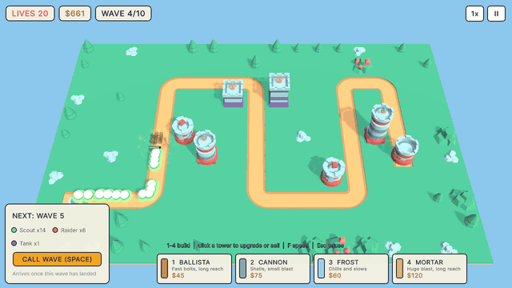
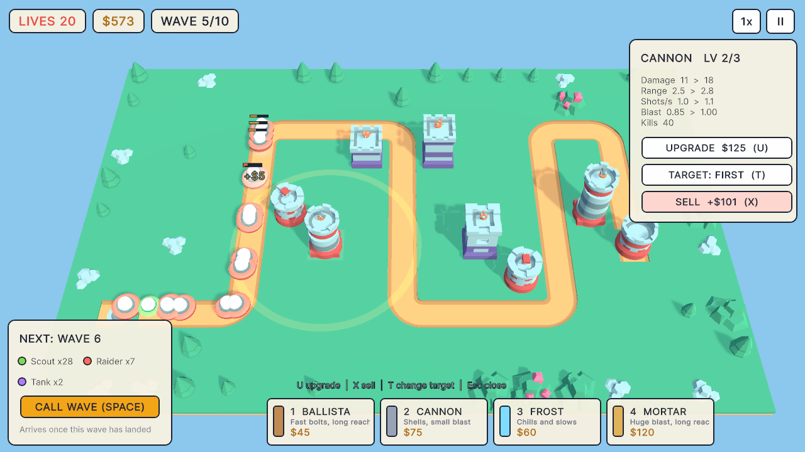
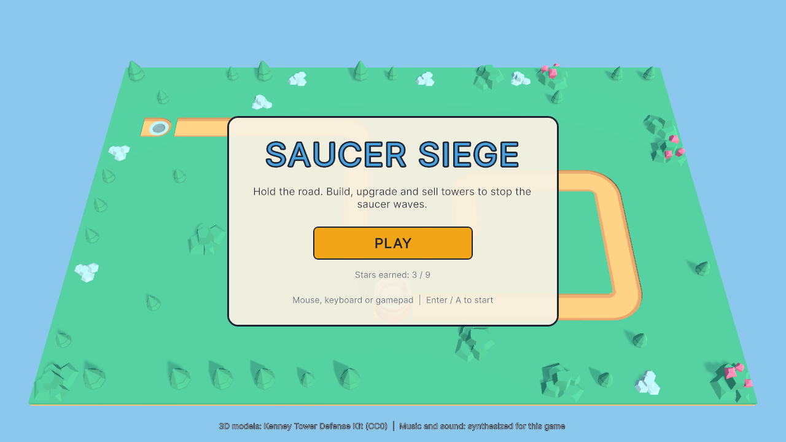
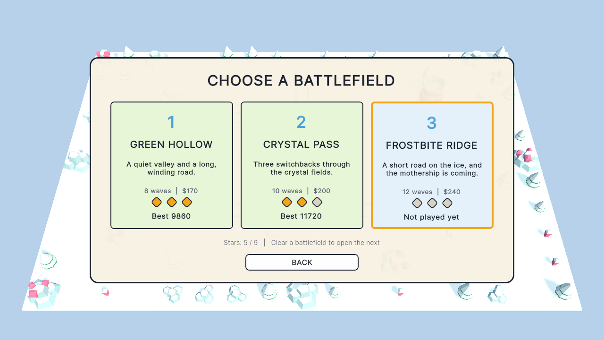
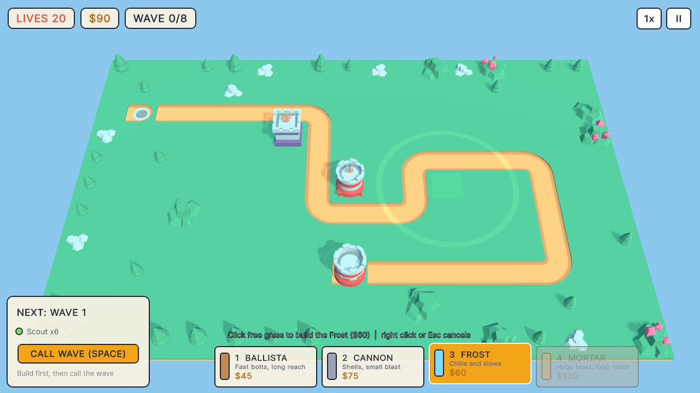
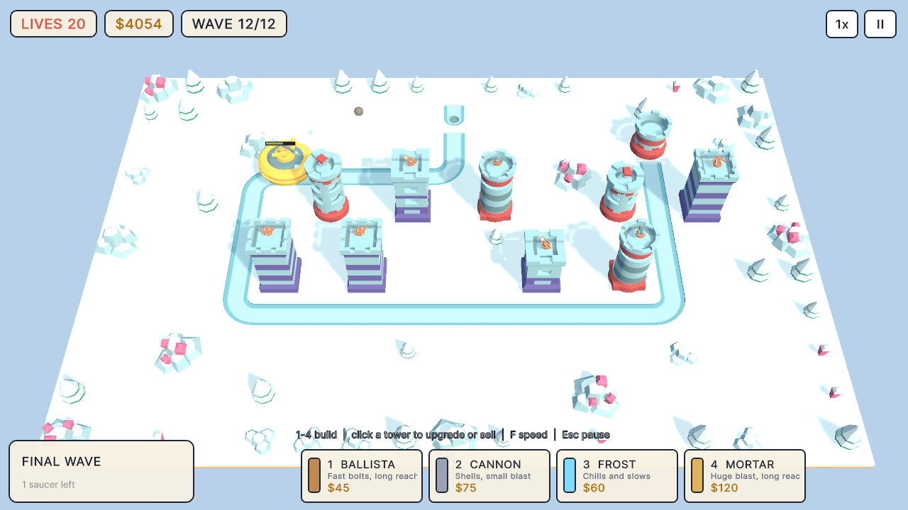
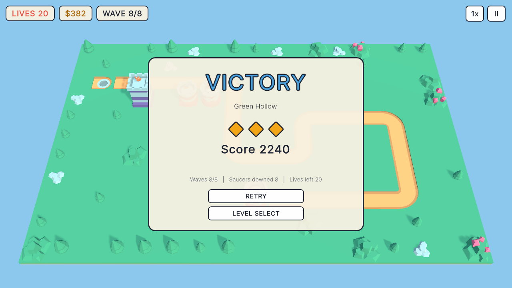

# Saucer Siege

A small 3D tower defense built with Unity: build, upgrade and sell four kinds of towers beside a
winding road to stop waves of flying saucers, across three battlefields that end with a mothership.





| | |
|---|---|
|  |  |
|  |  |
|  | |

## Play it

- **In your browser:** [trysac.github.io/TowerDefenseBasicTemplate](https://trysac.github.io/TowerDefenseBasicTemplate/)
- **On itch.io:** [trysac.itch.io/saucer-siege](https://trysac.itch.io/saucer-siege)
- **Get the code:** fork this repository, or clone it:

  ```bash
  git clone https://github.com/Trysac/TowerDefenseBasicTemplate.git
  ```

## Run it

1. Install **Unity 6000.3.27f1 (Unity 6 LTS)** with Unity Hub (add the Windows or Web build
   support module if you want to build players).
2. In Unity Hub choose **Add → Add project from disk** and select the repository folder.
3. Open `Assets/Scenes/SaucerSiege.unity` and press **Play**.

To build a player use **File → Build Profiles** (Windows or Web), or build from a terminal into
a folder outside the repository:

```bash
Unity -batchmode -quit -projectPath . -executeMethod SaucerSiege.EditorTools.ProjectBuilder.BuildWebGL -buildOutput ../build/web
```

(`BuildWindows` works the same way.) The WebGL build is uncompressed, so it runs from any
static host such as GitHub Pages.

The tests run from **Window → General → Test Runner** (EditMode and PlayMode), or from a terminal:

```bash
Unity -batchmode -projectPath . -runTests -testPlatform EditMode -testResults results.xml
Unity -batchmode -projectPath . -runTests -testPlatform PlayMode -testResults playmode.xml
```

The README screenshots come from an opt-in hook: run a built player with
`-screenshot <folder>` (optionally `-scenario title,levels,build,battle,upgrade,snow,victory`),
or, without a player,
`Unity -batchmode -projectPath . -executeMethod SaucerSiege.EditorTools.ProjectBuilder.CaptureScreenshots -screenshot <folder>`.

## Controls

| Action | Mouse | Keyboard | Gamepad |
|---|---|---|---|
| Pick a tower to build | Click a card | 1-4, or Q / E to step | LB / RB |
| Move the tile cursor | Point | Arrows or WASD | Left stick or D-pad |
| Build here, or select the tower here | Left click | Enter | A |
| Cancel building or close the tower panel | Right click | Esc or Backspace | B |
| Upgrade / sell / change target of the selected tower | Panel buttons | U / X / T | X / LT / RT |
| Call the next wave (early for a bonus) | Call wave button | Space or N | Y |
| Game speed 1x, 2x, 3x | Speed button | F | Select |
| Pause (volume settings inside) | II button | Esc or P | Start |
| Mute | Pause menu | M | — |
| Restart the level (pause or result screen) | Menu button | R | Y |
| Back to level select (pause or result screen) | Menu button | Q | X |

## How it plays

- **Battlefields.** Green Hollow (8 waves), Crystal Pass (10) and Frostbite Ridge (12, on snow).
  Clearing one opens the next. You start with 20 lives; each saucer that reaches the castle costs
  one (tanks two, the mothership ten). Stars: three for a flawless win, two with at least half of
  the lives left, one otherwise. Stars and the best score per battlefield are saved on the device.
- **Waves.** The first wave waits until you call it. Once a wave has finished landing, the next
  one starts after 14 seconds; calling it earlier pays $2 for every second left. Clearing a wave
  pays a bonus that grows with the wave number. The panel in the corner previews the next wave.
- **Towers** (each has three levels; selling returns 70% of everything spent on it):

  | Tower | Cost (upgrades) | Damage | Range | Shots/s | Special |
  |---|---|---|---|---|---|
  | Ballista | $45 ($50, $85) | 3 / 5 / 8 | 2.6-3.3 | 1.8-2.6 | homing bolts |
  | Cannon | $75 ($70, $125) | 7 / 11 / 18 | 2.3-2.8 | 0.9-1.1 | blast 0.7-1.0 tiles, leads its target |
  | Frost | $60 ($55, $90) | 1 / 2 / 3 | 2.2-2.7 | 1.3-1.7 | slows by 45-65% for 1.4-2.2 s, small blast from level 2 |
  | Mortar | $120 ($100, $165) | 12 / 19 / 30 | 3.6-4.5 | 0.4-0.5 | blast 1.2-1.6 tiles, lobbed shells that lead the target |

  Each tower aims at the saucer that is **first** along the road, or the **closest**, the
  **strongest** or the **last**, cycled with the target button.
- **Saucers:**

  | Saucer | Health | Speed (tiles/s) | Armour | Bounty |
  |---|---|---|---|---|
  | Scout | 6 | 2.1 | 0 | $3 |
  | Raider | 15 | 1.35 | 1 | $5 |
  | Tank | 42 | 0.85 | 4 | $11 |
  | Mothership | 420 | 0.55 | 3 | $80 |

  Armour is taken off every hit, but a hit always deals at least 1, so bolts barely scratch tanks.
  Health grows every wave, faster on the later battlefields.

## What I learned / technically interesting

- **Rules without the engine.** Maps, the road, waves, towers, targeting, projectiles, damage,
  the economy, records and the screen flow live in `Assets/Scripts/Core`, a plain C# assembly
  with no Unity references, covered by 57 EditMode tests. The Unity layer only renders, plays
  effects and reads input; 5 PlayMode tests drive the real scene (menus, win, loss, restart
  during the result beat, pause).
- **A bot keeps the game honest.** One EditMode test plays every battlefield with a simple bot
  (build on the tiles that cover the most road, then upgrade): it must win all three, and a thin
  defence must lose the last one. Balance changes that break either show up as a red test.
- **Fixed-step simulation.** The battle advances in 1/60 s steps whatever the frame rate, so 3x
  speed or a slow frame plays out exactly like normal speed. Lobbed shells aim where the target
  will be by iterating its position along the road against the flight time.
- **Levels are text.** Each battlefield is a few rows of characters; the road is traced from the
  landing pad to the castle and rejected if it branches or breaks. Kenney's road tiles are turned
  to fit by measuring, in the editor, which sides of each mesh the road material reaches.
- **Timers that cannot leak.** The beat between a battle ending and its result screen belongs to
  the session, and every screen change cancels it, so restarting or leaving during that beat can
  never pop an old result over a new battle.
- **Generated content.** The scene, materials, app icon and player settings come from an editor
  script (`ProjectBuilder.cs`); the music and sound effects come from a tiny Python synthesizer
  (`tools/audio`). The UI is UI Toolkit built in code, and input goes through the Input System,
  so mouse, keyboard and gamepad all work.
- **Rescuing old work.** This began in 2022 as a copy of a Zenva tower defense course project
  (Unity 2020.3, two towers, two enemy types, two waves, uGUI and TextMesh Pro). It was upgraded
  to Unity 6, its rules were pulled out of the MonoBehaviours (fixing four bugs on the way, each
  shown by a failing test first: double kills, waves ending between groups, a 10 m limit on the
  closest-target search and a repeated game over), and the template was rebuilt into the game above.

## Credits

- 3D models: [Tower Defense Kit](https://kenney.nl/assets/tower-defense-kit) by Kenney (CC0),
  in `Assets/Kenney/TowerDefenseKit` with its licence file.
- Base project: a Zenva tower defense course, which this repository started from in 2022; none
  of its scripts, prefabs or course-made models remain.
- Music and sound effects: synthesized for this game (`tools/audio`).

See [CREDITS.md](CREDITS.md).

## License

[MIT](LICENSE). The Kenney models are CC0.
